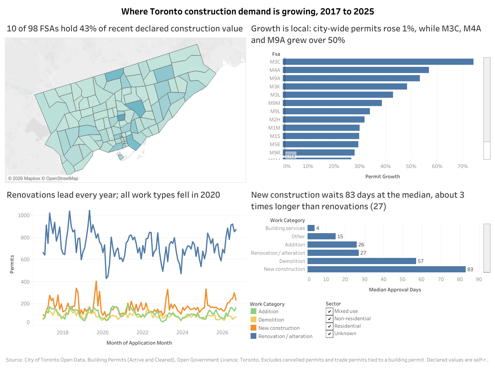

# Toronto Building Permits: Where Is Construction Demand Growing?

Capstone case study for the Google Data Analytics Professional Certificate, using real City of Toronto open data instead of the provided Cyclistic or Bellabeat datasets.

**Portfolio page:** https://mahmoud-o.github.io/toronto-building-permits/ (served by GitHub Pages from `docs/index.html`)

## Scenario

A Toronto building supply company wants to know where construction demand is growing so it can focus its sales reps and inventory.

**Business task:** identify where in Toronto construction activity is growing, what kind of work it is, and how quickly permits move, so the sales team can focus territory and product mix on the strongest demand.

**Stakeholders:** sales leadership, executive team, operations and inventory, analytics team.

## Guiding questions

1. Where is permit activity (count and declared construction value) concentrated and growing?
2. How is activity split between residential and non-residential, and new construction vs additions vs renovations?
3. How long do permits take from application to issuance, and does that vary by type or area?
4. How have volumes and values changed over time, and what seasonal patterns exist?

**Territory unit:** Forward Sortation Area (FSA), the first three characters of a postal code.

## Data

City of Toronto Open Data, released under the [Open Government Licence: Toronto](https://open.toronto.ca/open-data-license/):

- [Building Permits: Active Permits](https://open.toronto.ca/dataset/building-permits-active-permits/) (refreshed daily)
- [Building Permits: Cleared Permits](https://open.toronto.ca/dataset/building-permits-cleared-permits/) (the "Cleared Building Permits since 2017" file)

Scope: permits applied for from 1 January 2017 onward. The two datasets are combined, overlaps removed, and the latest revision kept per permit number.

**Known limitations:** permits signal intent, not completed construction; declared cost is self-reported and missing for many trade permits; dwelling units lost is rarely filled in; large projects carry several related permits that can inflate counts.

## Dashboard

**[View the interactive dashboard on Tableau Public](https://public.tableau.com/views/TorontoBuildingPermitsWhereConstructionDemandIsGrowing/Dashboard1)**



How it was built: [docs/tableau_build_guide.md](docs/tableau_build_guide.md).

## Key findings

From `notebooks/02_analysis.ipynb` (cancelled permits and trade permits tied to a building permit excluded; values are declared, nominal dollars):

- **Growth is local.** City-wide permits rose 1.4% from 2022-2023 to 2024-2025, but M3C (+74%), M4A (+57%) and M9A (+53%) grew far faster. M3C is also the second-largest area by recent declared value ($1.64B).
- **Value is concentrated.** 10 of 98 FSAs hold 43% of 2024-2025 declared value.
- **Residential leads in volume, not value.** Residential is 69% of permits but 35% of declared value; new construction is 10% of permits but 64% of value.
- **New construction is slow to approve.** Median 83 days from application to issuance, about 3 times renovations (27 days).
- **Fewer but larger projects.** 2025 permits were about 24% below 2017, while declared value rose from $6.8B to $16.9B. May to August is the busiest season.


## Repository layout

```
toronto-building-permits/
  README.md
  requirements.txt
  data/raw/            raw downloads (not committed; run scripts/download_data.py)
  data/clean/          cleaned table (not committed; rebuilt by 01_cleaning.ipynb)
  notebooks/
    01_cleaning.ipynb  Process phase
    02_analysis.ipynb  Analyze phase
  outputs/figures/
  outputs/summary_tables/
  docs/
    cleaning_log.md    every cleaning step and the rows it affected
    data_dictionary.md raw and derived columns
    tableau_build_guide.md  step-by-step dashboard build
    index.html         portfolio page (GitHub Pages)
    assets/            figures used by the portfolio page
  scripts/
    download_data.py   fetches both datasets from the City's open data API
    export_tableau.py  builds the permit-level data source for the dashboard
```

## How to reproduce (Windows)

```
py -m venv .venv
.venv\Scripts\activate
py -m pip install -r requirements.txt
py scripts\download_data.py
jupyter notebook notebooks\01_cleaning.ipynb
```

## Project status

| Phase | Status | Output |
|---|---|---|
| Ask, Prepare | Done | Case study document |
| Process | Done | `scripts/download_data.py`, `notebooks/01_cleaning.ipynb`, `docs/` |
| Analyze | Done | `notebooks/02_analysis.ipynb`, `outputs/summary_tables/` |
| Share | Done | [Tableau Public dashboard](https://public.tableau.com/views/TorontoBuildingPermitsWhereConstructionDemandIsGrowing/Dashboard1) |
| Act | In progress | Written case study, 5-minute deck, portfolio page (`docs/index.html`); LinkedIn post to come |
